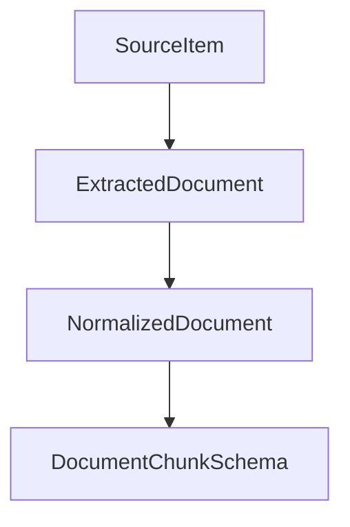

# Doc Ingest Engine

Production-ready **document parsing, text normalization, and structure-aware chunking engine** for enterprise RAG (Retrieval-Augmented Generation) and LLM systems. Built on **Pydantic v2**, **PyMuPDF**, and **python-docx**. Dependencies are managed with **[uv](https://docs.astral.sh/uv/)** or **pip**.

---

## Architecture

```mermaid
graph LR
    A["Raw Document<br/>(PDF, DOCX, XLSX, Notion)"] --> B["SourceItem<br/>(Pydantic v2)"]
    B --> C["ParserRouter<br/>(MIME detection)"]
    C --> D["Format Parser<br/>(PDF, DOCX, XLSX, Notion)"]
    D --> E["ExtractedDocument<br/>(Structured AST elements)"]
    E --> F["NormalizationService<br/>(Cleaner + SHA256 Hash)"]
    F --> G["NormalizedDocument<br/>(Cleaned TextSections)"]
    G --> H["ChunkingRouter<br/>(Format routing)"]
    H --> I["Structure Chunker<br/>(Breadcrumbs + Hierarchy)"]
    I --> J["DocumentChunkSchema<br/>(Vector & Citation Ready)"]
```




| Layer | Folder | Responsibility |
|---|---|---|
| **Schema** | `doc_ingest/schemas/` | Pydantic v2 models for file inputs, AST elements, normalized text, and chunk citations |
| **Parsers** | `doc_ingest/parsers/` | Format-specific extractors for PDF, DOCX, XLSX, and Notion with automatic MIME detection |
| **Normalizer** | `doc_ingest/normalizer/` | Text cleaning, soft-wrap repair, control char sanitization, and SHA256 content fingerprinting |
| **Chunking** | `doc_ingest/chunking/` | Hierarchy-aware chunkers preserving semantic heading boundaries, breadcrumbs, and token windows |
| **Pipeline** | `doc_ingest/pipeline.py` | Unified high-level orchestrator connecting Parse $\to$ Normalize $\to$ Chunk |
| **Tests** | `tests/` | Pytest suite validating parser extraction, text sanitization, chunk boundaries, and real documents |

> **Parsing vs Normalization vs Chunking:** Raw extraction lives in `parsers/` (converts binary files and Notion JSON into structured document elements). Text sanitization and cryptographic hashing live in `normalizer/`. Token sizing, sliding windows, and hierarchical preamble injection live in `chunking/`. All three are unified via `DocumentIngestionPipeline`.

---

## Project Structure

```text
doc-ingest-engine/
├── pyproject.toml              # Build backend (hatchling), dependencies, pytest config
├── README.md                   # Architecture, usage, and extension guide
├── tests/                      # Pytest suite
│   ├── test_cleaner.py         # Soft-wrap, control char, and whitespace tests
│   ├── test_normalizer.py      # Metadata consolidation & SHA256 hashing tests
│   ├── test_chunking.py        # Heading boundary, breadcrumb, and overlap tests
│   └── test_pipeline.py        # End-to-end multi-format execution tests
└── doc_ingest/
    ├── __init__.py             # Public API exports
    ├── pipeline.py             # High-level DocumentIngestionPipeline
    ├── schemas/                # Source of truth data models (Pydantic v2)
    │   ├── source_item.py      # Input file/stream descriptor
    │   ├── document_elements.py# AST elements (Heading, Paragraph, ListItem, Table)
    │   ├── extracted_document.py# Parser output container
    │   ├── normalized_document.py# Cleaner output with TextSection sequence
    │   └── chunk.py            # Vector-ready chunk DTO with citation metadata
    ├── normalizer/             # Cleaning & standardization
    │   ├── cleaner.py          # Regex-based text sanitation
    │   └── normalizer.py       # Metadata normalizer & SHA256 hash generator
    ├── parsers/                # Format extractors
    │   ├── base.py             # Abstract BaseParser interface
    │   ├── router.py           # MIME-type & extension routing
    │   ├── pdf_parser.py       # PyMuPDF span & font-size hierarchy parser
    │   ├── docx_parser.py      # python-docx XML AST & table extractor
    │   ├── xlsx_parser.py      # openpyxl sheet iterator
    │   └── notion_parser.py    # Block-tree recursive extractor
    └── chunking/               # Structure-aware chunking
        ├── base.py             # AbstractChunker (chunk_size=425, chunk_overlap=60)
        ├── router.py           # Content-type router for chunkers
        ├── pdf_chunker.py      # Section boundary & dangling heading rescue chunker
        ├── docx_chunker.py     # Heading boundary & markdown table preservation
        ├── xlsx_chunker.py     # Tabular row window chunker
        └── notion_chunker.py   # H1>H2 breadcrumb preamble injection chunker
```

---

## Pipeline Stages: Ingestion vs Output Artifacts

The pipeline decouples extraction, standardization, and chunking into **three distinct, testable phases**:

| Stage | Folder | What it does | Input $\to$ Output | Key Capabilities |
|---|---|---|---|---|
| **1. Parsing** | `doc_ingest/parsers/` | Extracts raw text, font metrics, headings, and tables from binary formats | `SourceItem` $\to$ `ExtractedDocument` | Preserves visual hierarchy as typed AST (`HeadingElement`, `TableElement`) |
| **2. Normalization** | `doc_ingest/normalizer/` | Strips control characters, repairs soft line breaks, generates SHA256 fingerprint | `ExtractedDocument` $\to$ `NormalizedDocument` | Deduplication hash & clean text sections |
| **3. Chunking** | `doc_ingest/chunking/` | Splits document along semantic boundaries, injects breadcrumb preambles | `NormalizedDocument` $\to$ `List[DocumentChunkSchema]` | Never breaks mid-heading; rescues dangling headers; injects breadcrumbs |

---

## Chunking Intelligence: Why Structure Matters

Traditional RAG systems split raw text arbitrarily every $N$ characters, causing **context fragmentation** and **orphaned headings**. This engine implements four structural guarantees:

### 1. Hierarchy & Breadcrumb Preservation
When documents have nested structures (e.g. `Heading 1 > Heading 2 > Paragraph`), every generated chunk is automatically prepended with its hierarchical breadcrumb:
```text
[Context: Phase 1 – Architecture > Microservices Setup]

The authentication service runs on port 8000 and requires PostgreSQL 16+...
```
This guarantees that vector embeddings carry full contextual meaning even when queried in isolation.

### 2. Dangling Heading Rescue
If a section exceeds the token window and ends on a short heading or title line without body content, the chunker **rescues** the heading, pops it off the current chunk, and places it at the beginning of the next chunk.

### 3. Smart Token Sizing
Configured by default for standard dense embedding models (`BAAI/bge-base-en-v1.5`, `text-embedding-3-small`):
* **`chunk_size`**: `425` tokens ($\sim 1700$ characters)
* **`chunk_overlap`**: `60` tokens ($\sim 240$ characters)
* Oversized single blocks (e.g. massive tables or monolithic paragraphs) gracefully fall back to sliding window chunking with breadcrumb retention.

---

## Getting Started

### 1. Install dependencies

Using **[uv](https://docs.astral.sh/uv/)** (recommended):
```bash
uv add "git+https://github.com/your-org/doc-ingest-engine.git"
```

Or install locally in editable mode for development:
```bash
uv pip install -e packages/doc-ingest-engine
# Or with standard pip:
pip install -e packages/doc-ingest-engine
```

### 2. Quick Start: One-Liner Ingestion

```python
from doc_ingest import DocumentIngestionPipeline

pipeline = DocumentIngestionPipeline()

# Ingest any PDF, Word (DOCX), Excel (XLSX), or Notion JSON file:
chunks = pipeline.process_file("path/to/contract.pdf")

for chunk in chunks:
    print(f"[{chunk.metadata.chunk_index}] Type: {chunk.metadata.chunk_type}")
    print(f"Context: {chunk.metadata.section_context}")
    print(f"Content: {chunk.content[:200]}...")
    print("-" * 60)
```

### 3. Granular Step-by-Step Usage

```python
from pathlib import Path
from datetime import datetime, timezone
from doc_ingest import (
    SourceItem,
    ParserRouter,
    NormalizationService,
    ChunkingRouter
)

# 1. Define the input source item
source_item = SourceItem(
    source_type="local",
    source_id="doc-001",
    content_type="docx",
    raw_path=Path("my_report.docx"),
    original_filename="my_report.docx",
    file_size=10240,
    uploaded_at=datetime.now(timezone.utc)
)

# 2. Parse into structured elements
parser = ParserRouter().route(source_item)
extracted_doc = parser.parse(source_item)

# 3. Clean and normalize
normalizer = NormalizationService()
normalized_doc = normalizer.normalize(extracted_doc)

# 4. Chunk with structure-aware logic
chunker = ChunkingRouter().route(normalized_doc)
chunks = chunker.chunk(normalized_doc)

print(f"Generated {len(chunks)} chunks with SHA256: {normalized_doc.content_hash}")
```

### 4. Run tests

Using `uv`:
```bash
uv run pytest packages/doc-ingest-engine/tests
```
Or directly with pytest:
```bash
pytest packages/doc-ingest-engine/tests
```

---

## uv Command Reference

| Command | Description |
|---|---|
| `uv pip install -e .` | Install package in editable development mode |
| `uv run pytest` | Run test suite with pytest |
| `uv build` | Build distributable `.tar.gz` and `.whl` artifacts |
| `uv publish` | Publish package to private/public PyPI index |

---

## API Overview

### Core Classes & Methods

| Class | Method | Purpose |
|---|---|---|
| `DocumentIngestionPipeline` | `.process_file(file_path, ...)` | End-to-end: Detect format $\to$ Parse $\to$ Normalize $\to$ Chunk |
| `DocumentIngestionPipeline` | `.process_source_item(source_item)` | Run pre-built `SourceItem` through full pipeline |
| `DocumentIngestionPipeline` | `.extract_and_normalize(source_item)` | Parse and clean only (skip chunking) |
| `ParserRouter` | `.detect_content_type(file_path)` | Determine MIME type via `python-magic` |
| `ParserRouter` | `.route(source_item)` | Return corresponding `BaseParser` instance |
| `NormalizationService` | `.normalize(extracted_doc)` | Clean text and compute deterministic SHA256 hash |
| `ChunkingRouter` | `.route(normalized_doc)` | Return corresponding `AbstractChunker` instance |

### Citation Metadata Schema (`ChunkMetadata`)

Each chunk output contains rich citation metadata ready for vector databases (`pgvector`, Qdrant, Pinecone):

| Field | Type | Description |
|---|---|---|
| `document_id` | `str` | Unique source identifier |
| `chunk_index` | `int` | Sequential chunk index within the document |
| `chunk_type` | `str` | Semantic element type (`paragraph`, `heading`, `table`, `section`) |
| `source_type` | `str` | Origin (`local`, `google_drive`, `notion`) |
| `source_url` | `str` | File path or external URL |
| `title` | `str` | Resolved document title |
| `page_number` | `int?` | PDF page number (1-indexed) |
| `sheet_name` | `str?` | Excel worksheet name |
| `heading_context` | `str?` | Immediate parent heading |
| `section_context` | `str?` | Full ancestor breadcrumb path (`Chapter 1 > Section A`) |

---

## Example Entities




All models inherit from **Pydantic v2 `BaseModel`** with full type annotations.

---

## Adding a New Feature (Extending the Engine)

### 1. Add Parser — `doc_ingest/parsers/<format>_parser.py`

```python
from doc_ingest.parsers.base import BaseParser
from doc_ingest.schemas.source_item import SourceItem
from doc_ingest.schemas.extracted_document import ExtractedDocument

class MarkdownParser(BaseParser):
    def supports(self, content_type: str) -> bool:
        return content_type == "markdown"

    def parse(self, source_item: SourceItem) -> ExtractedDocument:
        # Custom parsing logic here...
        return ExtractedDocument(source_item=source_item, raw_text=...)
```

### 2. Register in Parser Router — `doc_ingest/parsers/router.py`

Add `MarkdownParser()` to `self.parsers` and register MIME / extension mapping.

### 3. Add Chunker — `doc_ingest/chunking/<format>_chunker.py`

Extend `AbstractChunker` and implement `.chunk(doc: NormalizedDocument)`.

### 4. Register in Chunker Router — `doc_ingest/chunking/router.py`

Register format key in `self.chunkers`.

### 5. Add Unit Tests — `tests/test_<format>.py`

Write pytest test verifying parsing accuracy and chunk boundaries.

---

## Stack

| Component | Version / Tool |
|---|---|
| Python | $\ge 3.10$ |
| Pydantic | v2 ($\ge 2.0.0$) |
| PyMuPDF (`fitz`) | $\ge 1.23.0$ |
| python-docx | $\ge 1.0.0$ |
| openpyxl | $\ge 3.1.0$ |
| python-magic | $\ge 0.4.27$ |
| hatchling | PEP 621 build backend |
| pytest | Unit & integration testing |
| uv | Dependency & environment management |

---

## Decision Tree: Where Does This Go?

```text
New document format extractor?          → doc_ingest/parsers/<format>_parser.py
MIME detection / file routing rule?     → doc_ingest/parsers/router.py
Text sanitization / regex cleaning?     → doc_ingest/normalizer/cleaner.py
Metadata extraction / SHA256 hash?      → doc_ingest/normalizer/normalizer.py
Chunk size, token heuristics, overlap?  → doc_ingest/chunking/base.py
Format-specific chunking / breadcrumb?  → doc_ingest/chunking/<format>_chunker.py
Data models & DTO definitions?          → doc_ingest/schemas/
High-level end-to-end pipeline API?     → doc_ingest/pipeline.py
Unit & integration tests?               → tests/
```
